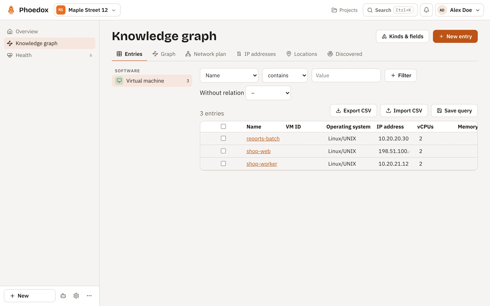

# AWS EC2

`com.phoedox.aws` · version 0.1.0



Imports the EC2 instances of an AWS account into the knowledge graph as VMs (name from the Name tag, instance type, state, private and public IP, platform, availability zone and region; terminated instances are skipped) and lists them for AI clients. Read-only: the only API call is DescribeInstances, signed with Signature Version 4.

## What it adds

- **Tools for AI clients (MCP):**
  - `aws.sync`: Import the EC2 instances of the configured regions into the knowledge graph now.
  - `aws.instances`: EC2 instances of the configured regions with name, type, state, private and public IP, availability zone, platform and launch time.
- **Runs on its own:** every 6 hours.

## Setup

1. A system administrator installs the plugin under **Administration → Plugins** (from the store, or the `.phxp` package).
2. A project owner enables it under **Project settings → Plugins** and enters the settings `access_key`, `secret_key`, `regions`.

**Settings:** access_key and secret_key (access key of an IAM user whose only policy is {"Version": "2012-10-17", "Statement": [{"Effect": "Allow", "Action": "ec2:DescribeInstances", "Resource": "*"}]}), regions (comma-separated, e.g. eu-central-1,us-east-1; supported: eu-central-1, eu-west-1, eu-west-2, eu-west-3, eu-north-1, eu-south-1, us-east-1, us-east-2, us-west-1, us-west-2).

## Permissions

- `graph:write:vm`: creates and updates entries of the kinds `vm`.
- `secrets:access_key`: stores the setting `access_key`, encrypted with the project.
- `secrets:secret_key`: stores the setting `secret_key`, encrypted with the project.
- `secrets:regions`: stores the setting `regions`, encrypted with the project.
- `net:fetch:ec2.eu-central-1.amazonaws.com`: calls only `ec2.eu-central-1.amazonaws.com`.
- `net:fetch:ec2.eu-west-1.amazonaws.com`: calls only `ec2.eu-west-1.amazonaws.com`.
- `net:fetch:ec2.eu-west-2.amazonaws.com`: calls only `ec2.eu-west-2.amazonaws.com`.
- `net:fetch:ec2.eu-west-3.amazonaws.com`: calls only `ec2.eu-west-3.amazonaws.com`.
- `net:fetch:ec2.eu-north-1.amazonaws.com`: calls only `ec2.eu-north-1.amazonaws.com`.
- `net:fetch:ec2.eu-south-1.amazonaws.com`: calls only `ec2.eu-south-1.amazonaws.com`.
- `net:fetch:ec2.us-east-1.amazonaws.com`: calls only `ec2.us-east-1.amazonaws.com`.
- `net:fetch:ec2.us-east-2.amazonaws.com`: calls only `ec2.us-east-2.amazonaws.com`.
- `net:fetch:ec2.us-west-1.amazonaws.com`: calls only `ec2.us-west-1.amazonaws.com`.
- `net:fetch:ec2.us-west-2.amazonaws.com`: calls only `ec2.us-west-2.amazonaws.com`.

## Development

```bash
go test ./plugins/aws/...
```

```bash
scripts/pack.sh aws
```

The package lands in `dist/com.phoedox.aws-0.1.0.phxp`. See the repository README for the layout of a plugin.
