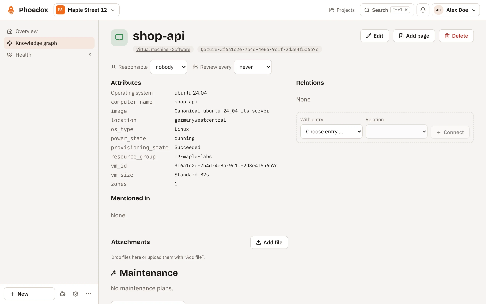

# Microsoft Azure

`com.phoedox.azure` · version 0.1.0



Imports the virtual machines of an Azure subscription into the knowledge graph as VMs (size, location, resource group, operating system and image, power state) and lists them for AI clients. Read-only: it signs in with client credentials at login.microsoftonline.com and only reads from Azure Resource Manager.

## What it adds

- **Tools for AI clients (MCP):**
  - `azure.sync`: Import the virtual machines of the configured subscription into the knowledge graph now.
  - `azure.vms`: Virtual machines of the configured subscription with resource group, location, size, operating system, power state and provisioning state.
- **Runs on its own:** every 6 hours.

## Setup

1. A system administrator installs the plugin under **Administration → Plugins** (from the store, or the `.phxp` package).
2. A project owner enables it under **Project settings → Plugins** and enters the settings `tenant_id`, `client_id`, `client_secret`, `subscription_id`.

**Settings:** tenant_id (directory ID), client_id and client_secret (an app registration with a client secret), subscription_id. The app registration needs the built-in role Reader on the subscription (it only needs Microsoft.Compute/virtualMachines/read); no write role.

## Permissions

- `graph:write:vm`: creates and updates entries of the kinds `vm`.
- `secrets:tenant_id`: stores the setting `tenant_id`, encrypted with the project.
- `secrets:client_id`: stores the setting `client_id`, encrypted with the project.
- `secrets:client_secret`: stores the setting `client_secret`, encrypted with the project.
- `secrets:subscription_id`: stores the setting `subscription_id`, encrypted with the project.
- `net:fetch:login.microsoftonline.com`: calls only `login.microsoftonline.com`.
- `net:fetch:management.azure.com`: calls only `management.azure.com`.

## Development

```bash
go test ./plugins/azure/...
```

```bash
scripts/pack.sh azure
```

The package lands in `dist/com.phoedox.azure-0.1.0.phxp`. See the repository README for the layout of a plugin.
