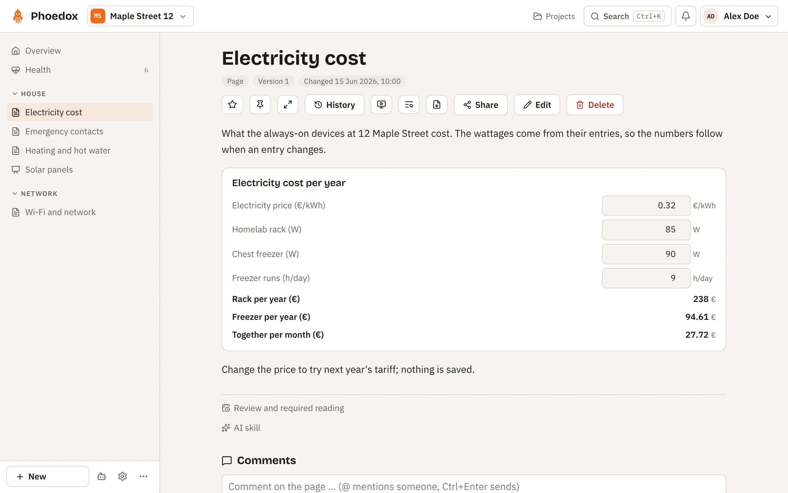

# Calculator

`com.phoedox.calc` · version 1.0.0

A ```calc block for pages and whiteboards: inputs and formulas, one line per value ("Label (unit) = number, formula or @entry.attribute"). Readers change the inputs and see the results at once, nothing is saved; inputs bound to an entry take its attribute from the knowledge graph. Formulas know + - * / ^ %, & for text, comparisons and SUM, AVERAGE, MIN, MAX, ROUND, CEIL, FLOOR, ABS, SQRT and IF.



## What it adds

- **Block** ```` ```calc ```` for pages and whiteboards, interactive in the web app through `<phx-calc>`.

## Example

`````markdown
```calc
title: Power cost of the NAS
Power (W) = 25
Electricity price (€/kWh) = 0.32
Hours per day (h) = 24
Cost per year (€) = Power * Hours_per_day * 365 / 1000 * Electricity_price
Cost per month (€) = Cost_per_year / 12
```
`````

This block used to be built into Phoedox. Pages and whiteboards that already use it keep working: Phoedox installs and enables this plugin where the block is used, or shows which plugin the block needs.

## Setup

1. A system administrator installs the plugin under **Administration → Plugins** (from the store, or the `.phxp` package).
2. A project owner enables it under **Project settings → Plugins**.

## Permissions

None: the plugin reads and writes nothing outside the block it draws.

## Development

```bash
go test ./plugins/calc/...
```

```bash
scripts/pack.sh calc
```

The package lands in `dist/com.phoedox.calc-1.0.0.phxp`. See the repository README for the layout of a plugin.
