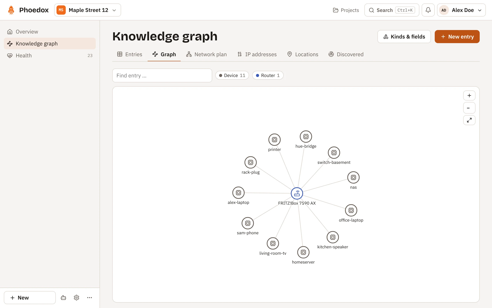

# FRITZ!Box

`com.phoedox.fritzbox` · version 0.1.0



Imports the FRITZ!Box (model, firmware, serial number) into the knowledge graph through TR-064 and lists the devices in the home network for AI clients; optionally imports active devices with "wired to" or "uplink" to the box.

## What it adds

- **Tools for AI clients (MCP):**
  - `fritz.sync`: Import the FRITZ!Box (and, if enabled, its active devices) into the knowledge graph now.
  - `fritz.hosts`: Devices known to the FRITZ!Box: name, IP, MAC, connection (LAN or Wi-Fi) and whether they are online.
- **Runs on its own:** every 6 hours.

## Setup

1. A system administrator installs the plugin under **Administration → Plugins** (from the store, or the `.phxp` package).
2. A project owner enables it under **Project settings → Plugins** and enters the settings `url`, `username`, `password`, `import_hosts`.

**Settings:** url (e.g. http://192.168.178.1:49000), username and password (a FRITZ!Box user with the right "FRITZ!Box settings"), optional import_hosts (yes to import devices). TR-064 must be enabled under Home Network → Network → Network Settings.

## Permissions

- `graph:read`: reads the entries of the project.
- `graph:write:router,device`: creates and updates entries of the kinds `router`, `device`.
- `secrets:url`: stores the setting `url`, encrypted with the project.
- `secrets:username`: stores the setting `username`, encrypted with the project.
- `secrets:password`: stores the setting `password`, encrypted with the project.
- `secrets:import_hosts`: stores the setting `import_hosts`, encrypted with the project.
- `net:fetch:config`: calls only the address entered as `url` in the plugin settings.

## Development

```bash
go test ./plugins/fritzbox/...
```

```bash
scripts/pack.sh fritzbox
```

The package lands in `dist/com.phoedox.fritzbox-0.1.0.phxp`. See the repository README for the layout of a plugin.
