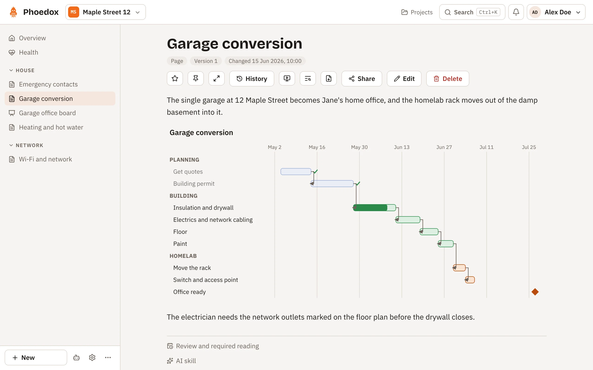

# Schedule (Gantt)

`com.phoedox.gantt` · version 1.0.0

A ```gantt block for pages and whiteboards: bars for tasks over time, sections, milestones, progress and dependencies as arrows, optionally with the cards of a board that have a due date.



## What it adds

- **Block** ```` ```gantt ```` for pages and whiteboards, interactive in the web app through `<phx-gantt>`.

## Example

`````markdown
```gantt
title: Bathroom renovation
today
## Planning
Get quotes [quotes]: 2026-01-05, 2w, done
Choose a contractor [choose]: after quotes, 3d
## Work
Demolition [demo]: after choose, 1w
Tiles: after demo, 10d, 30%
Done: 2026-03-20
```
`````

This block used to be built into Phoedox. Pages and whiteboards that already use it keep working: Phoedox installs and enables this plugin where the block is used, or shows which plugin the block needs.

## Setup

1. A system administrator installs the plugin under **Administration → Plugins** (from the store, or the `.phxp` package).
2. A project owner enables it under **Project settings → Plugins**.

## Permissions

None: the plugin reads and writes nothing outside the block it draws.

## Development

```bash
go test ./plugins/gantt/...
```

```bash
scripts/pack.sh gantt
```

The package lands in `dist/com.phoedox.gantt-1.0.0.phxp`. See the repository README for the layout of a plugin.
