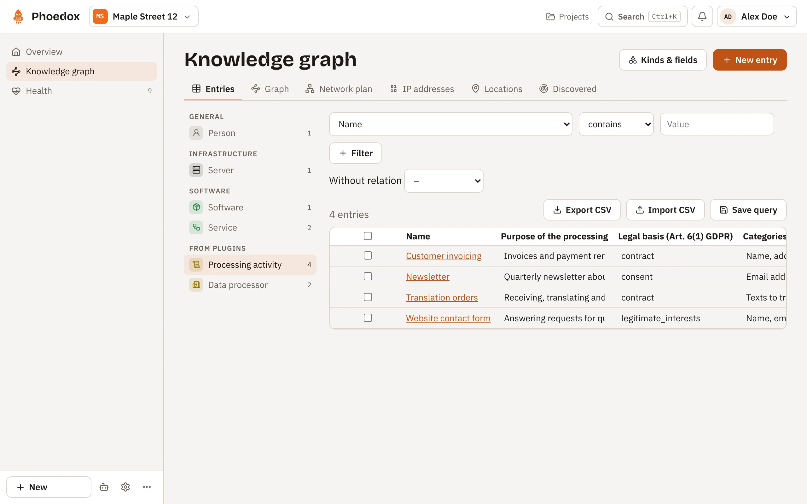

# GDPR record of processing activities

`com.phoedox.gdpr` · version 0.1.0



Keeps the record of processing activities (Art. 30 GDPR) as entries of the knowledge graph: the kind processing_activity (purpose, legal basis, categories of data and data subjects, recipients, third-country transfer and safeguards, retention, technical and organisational measures, contacts of the controller and the data protection officer, last review) and the kind data_processor (contact, date of the data processing agreement, country, link to the agreement). Link an activity with processed_by to the services, software, databases, servers, VMs, devices or persons involved, and with processor to its processors. AI clients get the record as Markdown (gdpr.register) and the activities with missing purpose, legal basis or retention or without a review in the last 12 months (gdpr.gaps). No settings and no network access; it only reads the project's entries and imports nothing. The plugin structures what you enter; it gives no legal advice and contains no legal texts.

## What it adds

- **Kinds of entries:** `processing_activity`, `data_processor`.
- **Relations:** `processed_by`, `processor`.
- **Tools for AI clients (MCP):**
  - `gdpr.register`: The record of processing activities (Art. 30 GDPR) as Markdown, built from the processing activities of the project with their systems and processors.
  - `gdpr.gaps`: Processing activities with missing purpose, legal basis or retention period, without a review in the last 12 months, or with a third-country transfer without safeguards; processors without a date of the data processing agreement.

## Setup

1. A system administrator installs the plugin under **Administration → Plugins** (from the store, or the `.phxp` package).
2. A project owner enables it under **Project settings → Plugins**.

## Permissions

- `graph:read`: reads the entries of the project.

## Development

```bash
go test ./plugins/gdpr/...
```

```bash
scripts/pack.sh gdpr
```

The package lands in `dist/com.phoedox.gdpr-0.1.0.phxp`. See the repository README for the layout of a plugin.
