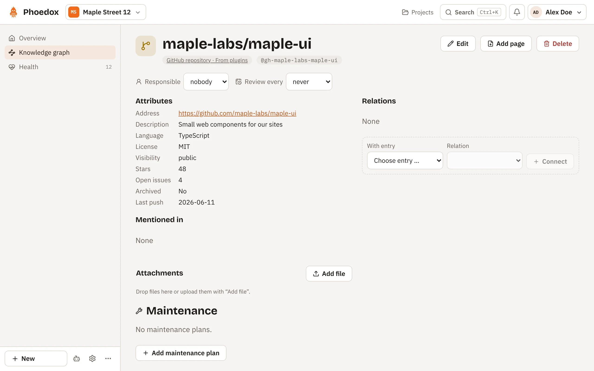

# GitHub

`com.phoedox.github` · version 0.1.0



Imports the repositories of a GitHub organization or account into the knowledge graph (language, licence, visibility, stars, last push) and lists open issues and pull requests for AI clients.

## What it adds

- **Kinds of entries:** `github_repo`.
- **Tools for AI clients (MCP):**
  - `github.sync`: Import the repositories of the configured owner now.
  - `github.open`: Open issues and pull requests of one repository of the configured owner.
- **Runs on its own:** every 6 hours.

## Setup

1. A system administrator installs the plugin under **Administration → Plugins** (from the store, or the `.phxp` package).
2. A project owner enables it under **Project settings → Plugins** and enters the settings `owner`, `token`.

**Settings:** owner (organization or account) and, optionally, token (a fine-grained, read-only token; needed for private repositories).

## Permissions

- `graph:read`: reads the entries of the project.
- `graph:write:github_repo`: creates and updates entries of the kinds `github_repo`.
- `secrets:owner`: stores the setting `owner`, encrypted with the project.
- `secrets:token`: stores the setting `token`, encrypted with the project.
- `net:fetch:api.github.com`: calls only `api.github.com`.

## Development

```bash
go test ./plugins/github/...
```

```bash
scripts/pack.sh github
```

The package lands in `dist/com.phoedox.github-0.1.0.phxp`. See the repository README for the layout of a plugin.
