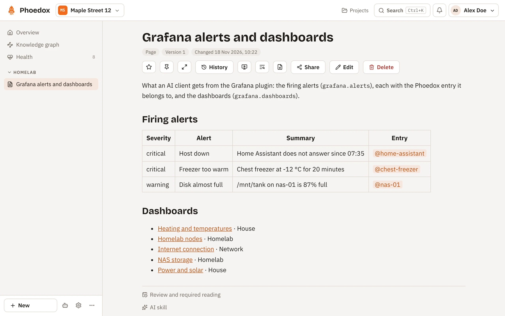

# Grafana

`com.phoedox.grafana` · version 0.1.0



Gives AI clients the dashboards of a Grafana instance (title, folder, link, tags; optionally filtered by a search text) and the firing Grafana-managed alerts with the Phoedox entry each alert belongs to (matched by its instance, host or hostname label). Read-only, no import.

## What it adds

- **Tools for AI clients (MCP):**
  - `grafana.dashboards`: Dashboards with title, folder, absolute link and tags, optionally filtered by a search text.
  - `grafana.alerts`: Firing Grafana-managed alerts: alert name, severity, instance, state, active since, summary and the matching Phoedox entry.

## Setup

1. A system administrator installs the plugin under **Administration → Plugins** (from the store, or the `.phxp` package).
2. A project owner enables it under **Project settings → Plugins** and enters the settings `url`, `token`.

**Settings:** url (e.g. https://grafana.example.org, including a sub path if Grafana is served from one) and token (a service account token with the Viewer role). The plugin reads the knowledge graph only to find matching entries.

## Permissions

- `graph:read`: reads the entries of the project.
- `secrets:url`: stores the setting `url`, encrypted with the project.
- `secrets:token`: stores the setting `token`, encrypted with the project.
- `net:fetch:config`: calls only the address entered as `url` in the plugin settings.

## Development

```bash
go test ./plugins/grafana/...
```

```bash
scripts/pack.sh grafana
```

The package lands in `dist/com.phoedox.grafana-0.1.0.phxp`. See the repository README for the layout of a plugin.
