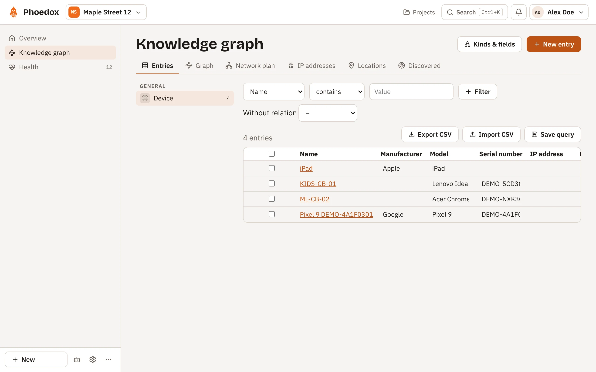

# Google Workspace

`com.phoedox.gworkspace` · version 0.1.0



Imports the ChromeOS and mobile devices of a Google Workspace account into the knowledge graph as devices (model, serial number, operating system and version, status, last sync, organizational unit for ChromeOS, and for mobile devices the display name of the owner; no e-mail addresses) and lists them for AI clients. Read-only: it uses the Admin SDK Directory API (admin.googleapis.com) with a service account and domain-wide delegation, signing in at oauth2.googleapis.com.

## What it adds

- **Tools for AI clients (MCP):**
  - `gworkspace.sync`: Import the ChromeOS and mobile devices of Google Workspace into the knowledge graph now.
  - `gworkspace.devices`: ChromeOS and mobile devices of Google Workspace with model, serial number, operating system, status, last sync and organizational unit.
- **Runs on its own:** every 6 hours.

## Setup

1. A system administrator installs the plugin under **Administration → Plugins** (from the store, or the `.phxp` package).
2. A project owner enables it under **Project settings → Plugins** and enters the settings `service_account_json`, `admin_email`.

**Settings:** service_account_json (the whole JSON key file of the service account; client_email and private_key are used) and admin_email (a Workspace administrator the service account acts as; needs the admin privileges to view ChromeOS and mobile devices). In the Admin console, Security, API controls, Domain-wide delegation, allow the service account's client ID the scopes https://www.googleapis.com/auth/admin.directory.device.chromeos.readonly and https://www.googleapis.com/auth/admin.directory.device.mobile.readonly; no write scope. Devices removed from Google Workspace stay in Phoedox until you delete them.

## Permissions

- `graph:write:device`: creates and updates entries of the kinds `device`.
- `secrets:service_account_json`: stores the setting `service_account_json`, encrypted with the project.
- `secrets:admin_email`: stores the setting `admin_email`, encrypted with the project.
- `net:fetch:oauth2.googleapis.com`: calls only `oauth2.googleapis.com`.
- `net:fetch:admin.googleapis.com`: calls only `admin.googleapis.com`.

## Development

```bash
go test ./plugins/gworkspace/...
```

```bash
scripts/pack.sh gworkspace
```

The package lands in `dist/com.phoedox.gworkspace-0.1.0.phxp`. See the repository README for the layout of a plugin.
