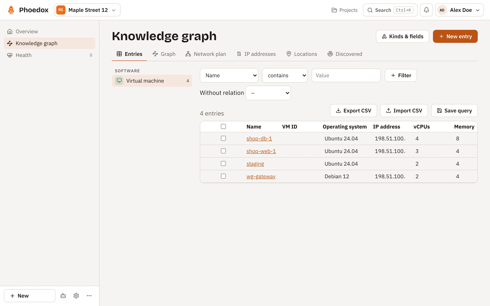

# Hetzner Cloud

`com.phoedox.hetzner` · version 0.1.0



Imports the servers of a Hetzner Cloud project into the knowledge graph as VMs (public IPv4, image, cores, memory, server type, datacenter, location and status) and lists them for AI clients with status, IP addresses and labels. Read-only.

## What it adds

- **Tools for AI clients (MCP):**
  - `hetzner.sync`: Import the servers of the Hetzner Cloud project into the knowledge graph now.
  - `hetzner.servers`: Servers of the Hetzner Cloud project with status, server type, location, public and private IP addresses and labels.
- **Runs on its own:** every 6 hours.

## Setup

1. A system administrator installs the plugin under **Administration → Plugins** (from the store, or the `.phxp` package).
2. A project owner enables it under **Project settings → Plugins** and enters the settings `token`.

**Settings:** token (an API token of the project with read permission only; Hetzner Cloud Console, Security, API tokens).

## Permissions

- `graph:write:vm`: creates and updates entries of the kinds `vm`.
- `secrets:token`: stores the setting `token`, encrypted with the project.
- `net:fetch:api.hetzner.cloud`: calls only `api.hetzner.cloud`.

## Development

```bash
go test ./plugins/hetzner/...
```

```bash
scripts/pack.sh hetzner
```

The package lands in `dist/com.phoedox.hetzner-0.1.0.phxp`. See the repository README for the layout of a plugin.
