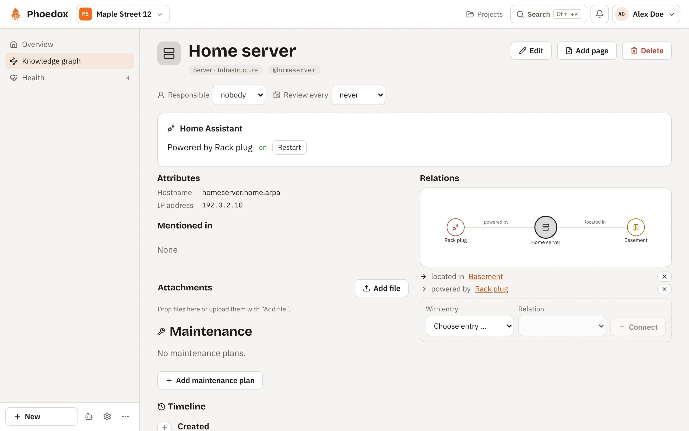

# Home Assistant

`com.phoedox.homeassistant` · version 0.5.0

Imports areas and devices from Home Assistant into the knowledge graph (rooms, devices, "located in"), shows switches on entries and switches devices, including a restart through the outlet a device is plugged into. Every 5 minutes it records measured values and switch states for the history on the entries. AI clients may only propose switching, unless the owner allows it per device.



## What it adds

- **Tools for AI clients (MCP):**
  - `ha.sync`: Import areas and devices from Home Assistant into the knowledge graph now.
  - `ha.record`: Record the current values of the imported Home Assistant entities now (sensors with numbers, switches as 1/0). Runs every 5 minutes on its own.
  - `ha.state`: Current state and attributes of Home Assistant entities, e.g. sensor.keller_temperatur.
  - `ha.controls`: The Home Assistant switch of an entry and the switch it is powered by (powered_by), with their states.
  - `ha.call`: Switch a Home Assistant switch, light, fan or input_boolean on, off or toggle it.
  - `ha.restart`: Restart a device by switching the switch it is powered by off, waiting (default 10 s) and on again.
- **Runs on its own:** every 5 minutes.
- **Frontend:** adds elements to the web app.

## Setup

1. A system administrator installs the plugin under **Administration → Plugins** (from the store, or the `.phxp` package).
2. A project owner enables it under **Project settings → Plugins** and enters the settings `url`, `token`.

**Settings:** url (e.g. https://ha.example.org) and token (a long-lived access token), or no settings at all when a Phoedox agent in the home network connects Home Assistant (homeassistant in agent.yaml); the agent then switches through a signed order.

## Permissions

- `graph:read`: reads the entries of the project.
- `graph:write:room,device,smart_plug,light`: creates and updates entries of the kinds `room`, `device`, `smart_plug`, `light`.
- `secrets:url`: stores the setting `url`, encrypted with the project.
- `secrets:token`: stores the setting `token`, encrypted with the project.
- `net:fetch:config`: calls only the address entered as `url` in the plugin settings.

## Development

```bash
go test ./plugins/homeassistant/...
```

```bash
scripts/pack.sh homeassistant
```

The package lands in `dist/com.phoedox.homeassistant-0.5.0.phxp`. See the repository README for the layout of a plugin.
