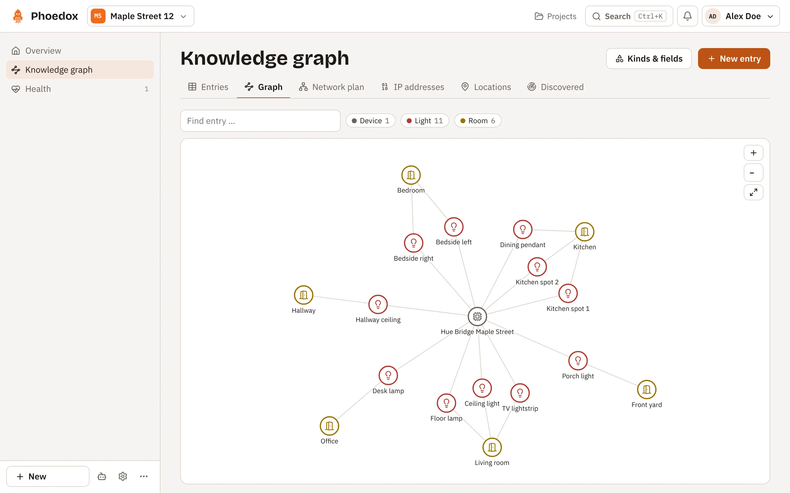

# Philips Hue

`com.phoedox.hue` · version 0.1.0



Imports a Philips Hue bridge into the knowledge graph: the bridge as a device (model, serial, IP address, MAC, firmware), its rooms as rooms (a room with the same name that already exists is reused, otherwise a new one is created) and its lights as lights (manufacturer, model, product, unique ID, firmware, reachable) "located in" their room and "related to" the bridge. AI clients get each light's on/off state, brightness and reachability. Read-only: the plugin only reads and never switches. Uses the local API v1 over plain HTTP, because the bridge's HTTPS certificate is signed by Signify's own CA, which Phoedox does not trust; zones, entertainment areas, sensors and scenes are not imported, and Matter devices that are not paired with the bridge cannot be reached over HTTP.

## What it adds

- **Tools for AI clients (MCP):**
  - `hue.sync`: Import the Hue bridge, its rooms and lights into the knowledge graph now.
  - `hue.lights`: Lights of the Hue bridge with room, on/off, brightness (percent), reachable, type and model.
- **Runs on its own:** every 6 hours.

## Setup

1. A system administrator installs the plugin under **Administration → Plugins** (from the store, or the `.phxp` package).
2. A project owner enables it under **Project settings → Plugins** and enters the settings `url`, `username`.

**Settings:** url (the bridge, e.g. http://192.168.1.20) and username (an application key of the bridge: press the link button, then POST {"devicetype":"phoedox#server"} to http://<bridge>/api; it is part of the request path, so keep the bridge on a trusted network).

## Permissions

- `graph:read`: reads the entries of the project.
- `graph:write:device,room,light`: creates and updates entries of the kinds `device`, `room`, `light`.
- `secrets:url`: stores the setting `url`, encrypted with the project.
- `secrets:username`: stores the setting `username`, encrypted with the project.
- `net:fetch:config`: calls only the address entered as `url` in the plugin settings.

## Development

```bash
go test ./plugins/hue/...
```

```bash
scripts/pack.sh hue
```

The package lands in `dist/com.phoedox.hue-0.1.0.phxp`. See the repository README for the layout of a plugin.
