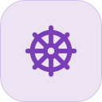
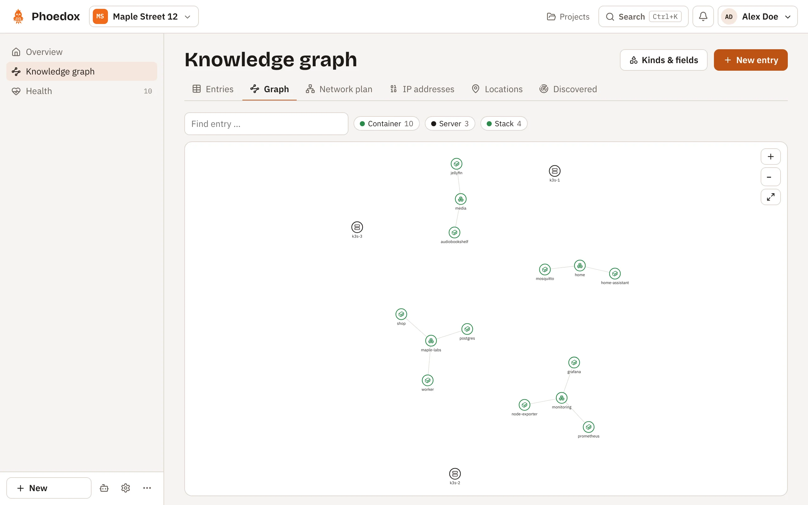

# Kubernetes

`com.phoedox.kubernetes` · version 0.1.0



Imports a Kubernetes cluster into the knowledge graph: nodes as servers (OS image, kubelet version, internal IP, CPU and memory), namespaces with workloads as stacks and Deployments, StatefulSets and DaemonSets as containers (first image, ready/desired replicas) that are part of their namespace. kube-system is skipped unless include_system is yes. AI clients can list pods and the warning events of the last hour. Read-only.

## What it adds

- **Tools for AI clients (MCP):**
  - `k8s.sync`: Import the cluster's nodes, namespaces and workloads into the knowledge graph now.
  - `k8s.pods`: Pods with namespace, name, phase, ready containers, restarts, node and age; optionally of one namespace.
  - `k8s.events`: Warning events of the last hour (object, reason, message, count); optionally of one namespace.
- **Runs on its own:** every hour.

## Setup

1. A system administrator installs the plugin under **Administration → Plugins** (from the store, or the `.phxp` package).
2. A project owner enables it under **Project settings → Plugins** and enters the settings `url`, `token`, `cluster`, `include_system`.

**Settings:** url (API server, e.g. https://k8s.example.org:6443; it needs a certificate the Phoedox host trusts), token (bearer token of a read-only service account), optional cluster (name used in entry IDs; default: the host of url), optional include_system (yes to include kube-system). Minimal ClusterRole for the service account: apiVersion: rbac.authorization.k8s.io/v1, kind: ClusterRole, rules: [{apiGroups: [""], resources: [nodes, namespaces, pods, events], verbs: [get, list]}, {apiGroups: [apps], resources: [deployments, statefulsets, daemonsets], verbs: [get, list]}].

## Permissions

- `graph:write:server,stack,container`: creates and updates entries of the kinds `server`, `stack`, `container`.
- `secrets:url`: stores the setting `url`, encrypted with the project.
- `secrets:token`: stores the setting `token`, encrypted with the project.
- `secrets:cluster`: stores the setting `cluster`, encrypted with the project.
- `secrets:include_system`: stores the setting `include_system`, encrypted with the project.
- `net:fetch:config`: calls only the address entered as `url` in the plugin settings.

## Development

```bash
go test ./plugins/kubernetes/...
```

```bash
scripts/pack.sh kubernetes
```

The package lands in `dist/com.phoedox.kubernetes-0.1.0.phxp`. See the repository README for the layout of a plugin.
