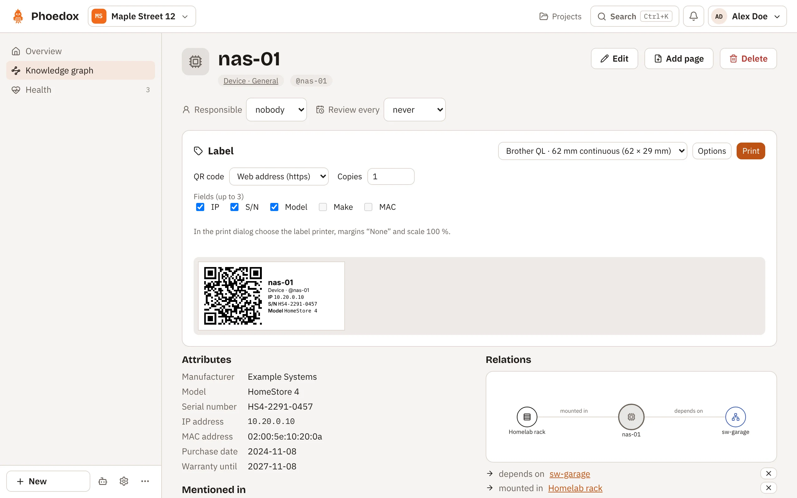

# Labels

`com.phoedox.labels` · version 0.1.0

Prints labels for entries from the browser: name, kind and up to three fields (IP address, host name, serial number, model, manufacturer, MAC address, asset tag, inventory number) next to a QR code that the Phoedox app recognises when scanning. The QR code holds the web address https://<instance>/e/<project>/<entry> or the app link phx://e/<project>/<entry>. Sizes: Brother QL 62 mm continuous tape (cut at 29 mm), Dymo 54 × 25 mm (11352) and Dymo 89 × 36 mm (99012); printing uses the browser's print dialog with the label size, so choose the label printer, no margins and 100 % scale there. Shown on entries of physical kinds (devices, servers, network gear, racks, patch panels, outlets, rooms …). No settings, no backend and no network access: the QR code is generated in the browser; it only reads the entry that is open.



## What it adds

- **Frontend:** runs in the browser (no backend).

## Setup

1. A system administrator installs the plugin under **Administration → Plugins** (from the store, or the `.phxp` package).
2. A project owner enables it under **Project settings → Plugins**.

## Permissions

- `graph:read`: reads the entries of the project.

## Development

```bash
go test ./plugins/labels/...
```

```bash
scripts/pack.sh labels
```

The package lands in `dist/com.phoedox.labels-0.1.0.phxp`. See the repository README for the layout of a plugin.
