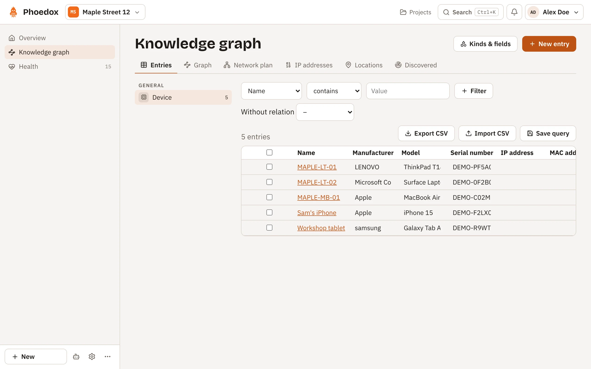

# Microsoft 365 (Intune)

`com.phoedox.m365` · version 0.1.0



Imports the devices managed by Microsoft Intune into the knowledge graph as devices (name, manufacturer, model, serial number, operating system and version, compliance state, last sync, and the display name of the primary user; no e-mail addresses) and lists them and the subscribed Microsoft 365 licenses (consumed and available units per SKU) for AI clients. Read-only: it signs in with client credentials at login.microsoftonline.com and only reads from Microsoft Graph (graph.microsoft.com).

## What it adds

- **Tools for AI clients (MCP):**
  - `m365.sync`: Import the Intune managed devices into the knowledge graph now.
  - `m365.devices`: Intune managed devices with operating system, model, serial number, compliance state, last sync and the display name of the primary user.
  - `m365.licenses`: Subscribed Microsoft 365 licenses (SKUs) with enabled, consumed and available units.
- **Runs on its own:** every 6 hours.

## Setup

1. A system administrator installs the plugin under **Administration → Plugins** (from the store, or the `.phxp` package).
2. A project owner enables it under **Project settings → Plugins** and enters the settings `tenant_id`, `client_id`, `client_secret`.

**Settings:** tenant_id (directory ID or primary domain), client_id and client_secret (an app registration with a client secret). The app registration needs the Microsoft Graph application permissions DeviceManagementManagedDevices.Read.All (devices) and Organization.Read.All (licenses), with admin consent; no write permission. Devices removed from Intune stay in Phoedox until you delete them.

## Permissions

- `graph:write:device`: creates and updates entries of the kinds `device`.
- `secrets:tenant_id`: stores the setting `tenant_id`, encrypted with the project.
- `secrets:client_id`: stores the setting `client_id`, encrypted with the project.
- `secrets:client_secret`: stores the setting `client_secret`, encrypted with the project.
- `net:fetch:login.microsoftonline.com`: calls only `login.microsoftonline.com`.
- `net:fetch:graph.microsoft.com`: calls only `graph.microsoft.com`.

## Development

```bash
go test ./plugins/m365/...
```

```bash
scripts/pack.sh m365
```

The package lands in `dist/com.phoedox.m365-0.1.0.phxp`. See the repository README for the layout of a plugin.
