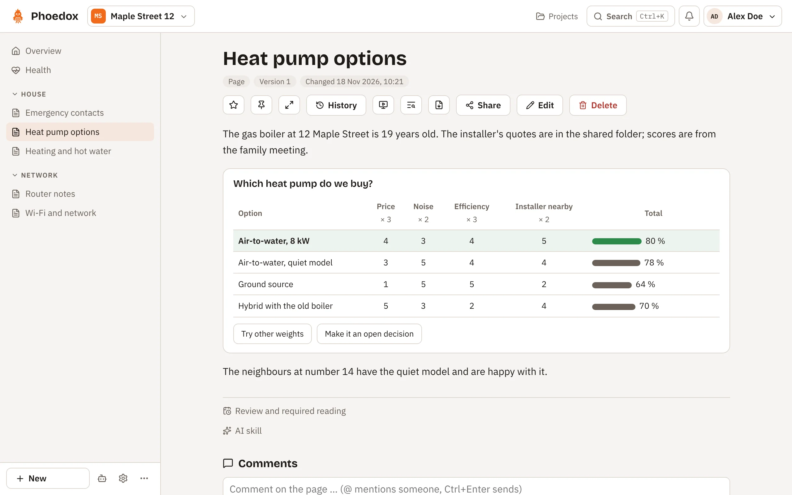

# Decision matrix

`com.phoedox.matrix` · version 1.0.0

A ```matrix block for pages and whiteboards: options scored against weighted criteria, totals as bars with the best option highlighted. Readers can try other weights without saving them, and the options can become an open decision in one click.



## What it adds

- **Block** ```` ```matrix ```` for pages and whiteboards, interactive in the web app through `<phx-matrix>`.

## Example

`````markdown
```matrix
title: Which NAS do we buy?
criteria: Price*3, Noise*2, Storage*3, Power use*1
scale: 1-5
- Synology DS224+: 3, 4, 3, 4
- QNAP TS-264: 4, 3, 4, 3
- Self-built: 5, 2, 5, 2
```
`````

This block used to be built into Phoedox. Pages and whiteboards that already use it keep working: Phoedox installs and enables this plugin where the block is used, or shows which plugin the block needs.

## Setup

1. A system administrator installs the plugin under **Administration → Plugins** (from the store, or the `.phxp` package).
2. A project owner enables it under **Project settings → Plugins**.

## Permissions

None: the plugin reads and writes nothing outside the block it draws.

## Development

```bash
go test ./plugins/matrix/...
```

```bash
scripts/pack.sh matrix
```

The package lands in `dist/com.phoedox.matrix-1.0.0.phxp`. See the repository README for the layout of a plugin.
