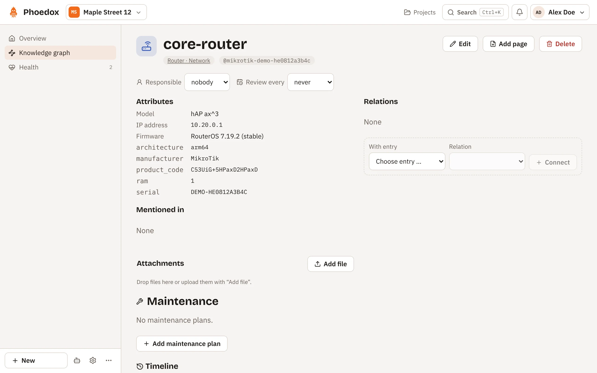

# MikroTik RouterOS

`com.phoedox.mikrotik` · version 0.1.0



Imports a MikroTik router running RouterOS v7 (identity, board and model, RouterOS version, serial number) into the knowledge graph through the REST API and gives AI clients its interfaces with addresses and the DHCP leases. Read-only.

## What it adds

- **Tools for AI clients (MCP):**
  - `mikrotik.sync`: Import the MikroTik router into the knowledge graph now.
  - `mikrotik.interfaces`: Interfaces of the MikroTik router: name, type, running, disabled, MAC address, comment and IP addresses.
  - `mikrotik.leases`: DHCP leases of the MikroTik router: address, MAC address, hostname, status, server and last seen.
- **Runs on its own:** every 6 hours.

## Setup

1. A system administrator installs the plugin under **Administration → Plugins** (from the store, or the `.phxp` package).
2. A project owner enables it under **Project settings → Plugins** and enters the settings `url`, `username`, `password`.

**Settings:** url (e.g. https://192.168.88.1; the www-ssl service must be enabled with a valid certificate), username and password (a RouterOS user in a group with the read and rest-api policies, e.g. a copy of the built-in read group). SNMP-only devices such as Cisco or Aruba switches are not covered by this plugin.

## Permissions

- `graph:write:router`: creates and updates entries of the kinds `router`.
- `secrets:url`: stores the setting `url`, encrypted with the project.
- `secrets:username`: stores the setting `username`, encrypted with the project.
- `secrets:password`: stores the setting `password`, encrypted with the project.
- `net:fetch:config`: calls only the address entered as `url` in the plugin settings.

## Development

```bash
go test ./plugins/mikrotik/...
```

```bash
scripts/pack.sh mikrotik
```

The package lands in `dist/com.phoedox.mikrotik-0.1.0.phxp`. See the repository README for the layout of a plugin.
