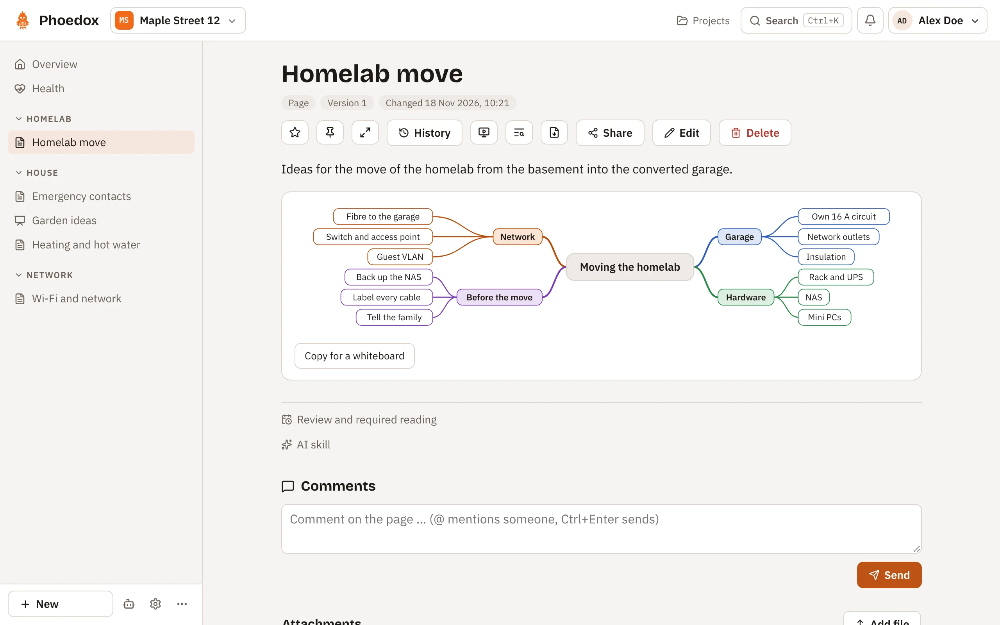

# Mind map

`com.phoedox.mindmap` · version 1.0.0

A ```mindmap block for pages and whiteboards: an indented outline (spaces, tabs or "- " lists) drawn as a mind map with the first line in the middle and its branches to both sides. Readers collapse and expand branches and copy the map onto a whiteboard as shapes.



## What it adds

- **Block** ```` ```mindmap ```` for pages and whiteboards, interactive in the web app through `<phx-mindmap>`.

## Example

`````markdown
```mindmap
Moving house
  Flat
    Give notice
    Handover with a report
  Internet
    Move the contract
    Take the router along
  Boxes
    Kitchen
    Cellar
```
`````

This block used to be built into Phoedox. Pages and whiteboards that already use it keep working: Phoedox installs and enables this plugin where the block is used, or shows which plugin the block needs.

## Setup

1. A system administrator installs the plugin under **Administration → Plugins** (from the store, or the `.phxp` package).
2. A project owner enables it under **Project settings → Plugins**.

## Permissions

None: the plugin reads and writes nothing outside the block it draws.

## Development

```bash
go test ./plugins/mindmap/...
```

```bash
scripts/pack.sh mindmap
```

The package lands in `dist/com.phoedox.mindmap-1.0.0.phxp`. See the repository README for the layout of a plugin.
