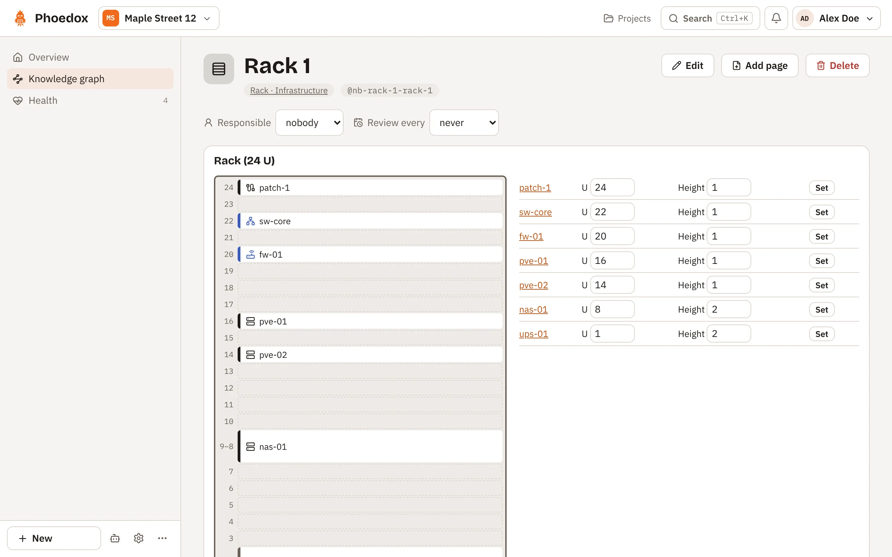

# NetBox

`com.phoedox.netbox` · version 0.1.0



Imports locations, racks and devices from NetBox into the knowledge graph: locations as rooms, racks with their height, devices by role as router, switch, access point, server, patch panel or device, mounted in their rack at their unit. AI clients can search devices and list IP prefixes.

## What it adds

- **Tools for AI clients (MCP):**
  - `netbox.sync`: Import NetBox locations, racks and devices into the knowledge graph now.
  - `netbox.find`: Search NetBox devices by name, serial number, asset tag or IP address.
  - `netbox.prefixes`: IP prefixes from NetBox with VLAN, status and description.
- **Runs on its own:** every 6 hours.

## Setup

1. A system administrator installs the plugin under **Administration → Plugins** (from the store, or the `.phxp` package).
2. A project owner enables it under **Project settings → Plugins** and enters the settings `url`, `token`.

**Settings:** url (e.g. https://netbox.example.org) and token (a read-only API token).

## Permissions

- `graph:read`: reads the entries of the project.
- `graph:write:room,rack,router,switch,access_point,server,patch_panel,device`: creates and updates entries of the kinds `room`, `rack`, `router`, `switch`, `access_point`, `server`, `patch_panel`, `device`.
- `secrets:url`: stores the setting `url`, encrypted with the project.
- `secrets:token`: stores the setting `token`, encrypted with the project.
- `net:fetch:config`: calls only the address entered as `url` in the plugin settings.

## Development

```bash
go test ./plugins/netbox/...
```

```bash
scripts/pack.sh netbox
```

The package lands in `dist/com.phoedox.netbox-0.1.0.phxp`. See the repository README for the layout of a plugin.
