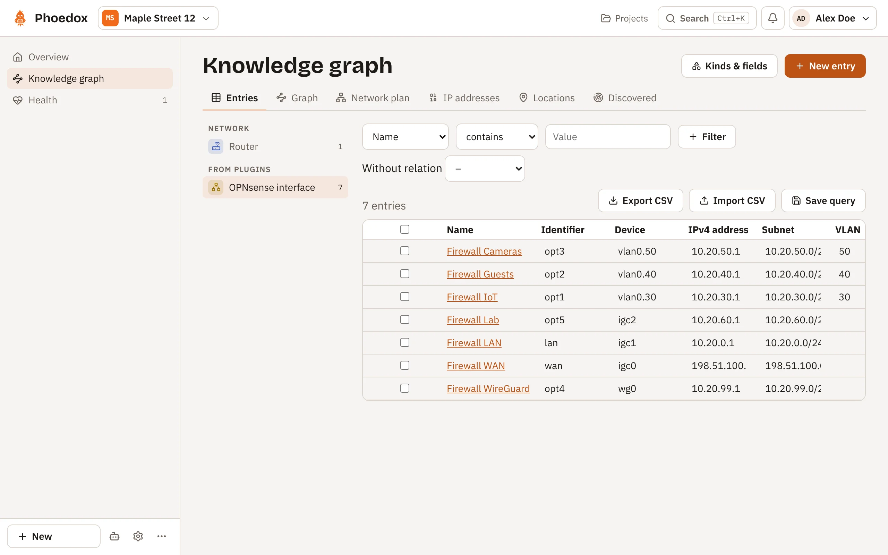

# OPNsense

`com.phoedox.opnsense` · version 0.1.0



Imports the OPNsense firewall (version) and its interfaces with address, subnet and VLAN into the knowledge graph and gives AI clients the DHCP leases and gateway status.

## What it adds

- **Kinds of entries:** `opnsense_interface`.
- **Relations:** `part_of`.
- **Tools for AI clients (MCP):**
  - `opnsense.sync`: Import the firewall and its interfaces into the knowledge graph now.
  - `opnsense.leases`: Current DHCPv4 leases: address, MAC, hostname, interface and state.
  - `opnsense.gateways`: Gateways with status, delay and packet loss.
- **Runs on its own:** every 6 hours.

## Setup

1. A system administrator installs the plugin under **Administration → Plugins** (from the store, or the `.phxp` package).
2. A project owner enables it under **Project settings → Plugins** and enters the settings `url`, `key`, `secret`, `name`.

**Settings:** url (e.g. https://fw.example.org), key and secret (API key of a user with read-only access to Diagnostics, Interfaces, DHCP and Gateways), optional name (default: OPNsense).

## Permissions

- `graph:read`: reads the entries of the project.
- `graph:write:router,opnsense_interface`: creates and updates entries of the kinds `router`, `opnsense_interface`.
- `secrets:url`: stores the setting `url`, encrypted with the project.
- `secrets:key`: stores the setting `key`, encrypted with the project.
- `secrets:secret`: stores the setting `secret`, encrypted with the project.
- `secrets:name`: stores the setting `name`, encrypted with the project.
- `net:fetch:config`: calls only the address entered as `url` in the plugin settings.

## Development

```bash
go test ./plugins/opnsense/...
```

```bash
scripts/pack.sh opnsense
```

The package lands in `dist/com.phoedox.opnsense-0.1.0.phxp`. See the repository README for the layout of a plugin.
