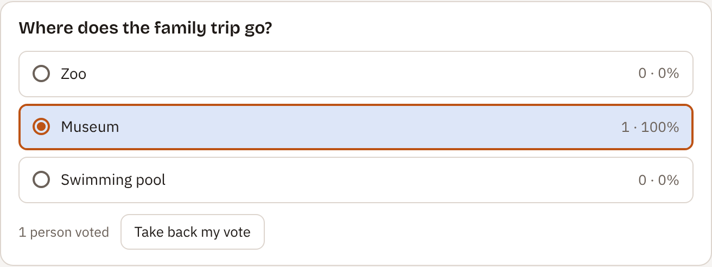

# Poll

`com.phoedox.poll` · version 1.0.0

A ```poll block for pages and whiteboards: a question and its answers as a list ("- …"). Every signed-in reader has their own vote – one answer, or several with "multiple: yes" – and can change or take it back. Readers only ever see how many people chose each answer, never who. The results appear after voting ("results: always" shows them from the start), "closed: yes" ends the poll and "id: …" keeps the votes when the text changes.



## What it adds

- **Block** ```` ```poll ```` for pages and whiteboards, interactive in the web app through `<phx-poll>` (it also runs live on whiteboards).

## Example

`````markdown
```poll
question: Where does the family trip go?
- Zoo
- Museum
- Swimming pool
```
`````

This block used to be built into Phoedox. Pages and whiteboards that already use it keep working: Phoedox installs and enables this plugin where the block is used, or shows which plugin the block needs.

## Setup

1. A system administrator installs the plugin under **Administration → Plugins** (from the store, or the `.phxp` package).
2. A project owner enables it under **Project settings → Plugins**.

## Permissions

None: the plugin reads and writes nothing outside the block it draws.

## Development

```bash
go test ./plugins/poll/...
```

```bash
scripts/pack.sh poll
```

The package lands in `dist/com.phoedox.poll-1.0.0.phxp`. See the repository README for the layout of a plugin.
