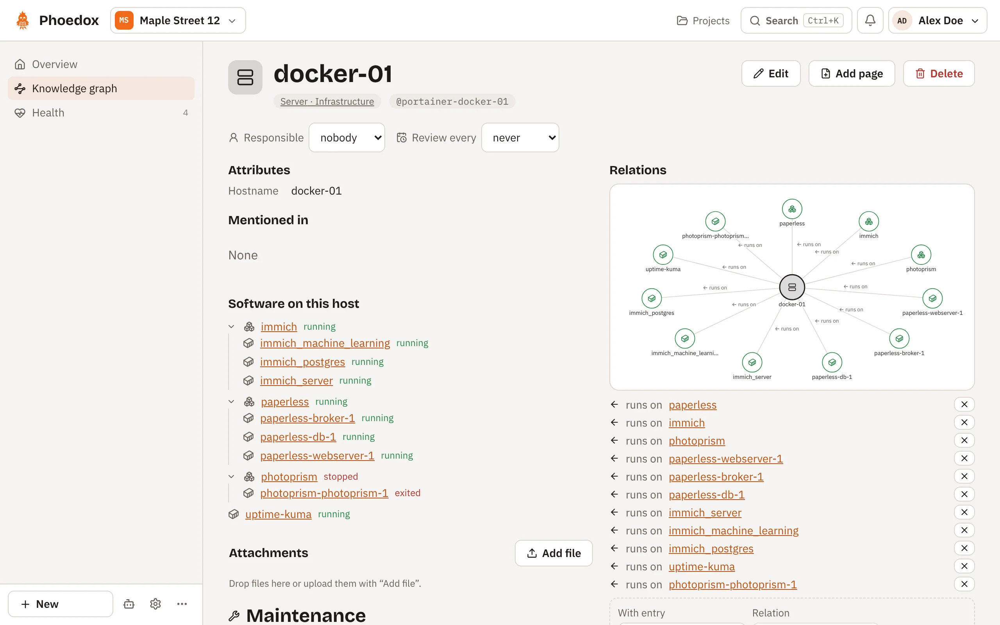

# Portainer

`com.phoedox.portainer` · version 0.1.0



Imports Docker environments, stacks and containers from Portainer into the knowledge graph (server, stack, container, "runs on", "part of") and shows AI clients their state.

## What it adds

- **Tools for AI clients (MCP):**
  - `portainer.sync`: Import Portainer environments, stacks and containers into the knowledge graph now.
  - `portainer.containers`: State, image and published ports of all containers in all Portainer environments.
- **Runs on its own:** every hour.

## Setup

1. A system administrator installs the plugin under **Administration → Plugins** (from the store, or the `.phxp` package).
2. A project owner enables it under **Project settings → Plugins** and enters the settings `url`, `token`.

**Settings:** url (e.g. https://portainer.example.org:9443) and token (Portainer access token; a read-only user is enough).

## Permissions

- `graph:read`: reads the entries of the project.
- `graph:write:server,stack,container`: creates and updates entries of the kinds `server`, `stack`, `container`.
- `secrets:url`: stores the setting `url`, encrypted with the project.
- `secrets:token`: stores the setting `token`, encrypted with the project.
- `net:fetch:config`: calls only the address entered as `url` in the plugin settings.

## Development

```bash
go test ./plugins/portainer/...
```

```bash
scripts/pack.sh portainer
```

The package lands in `dist/com.phoedox.portainer-0.1.0.phxp`. See the repository README for the layout of a plugin.
