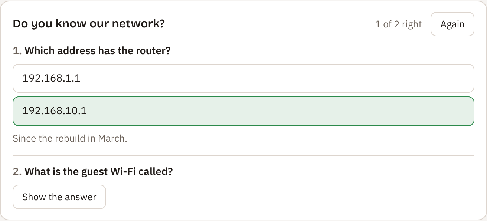

# Quiz

`com.phoedox.quiz` · version 1.0.0

A ```quiz block for pages: questions with right and wrong answers ("? question", "+ right", "- wrong") or flashcards to turn over ("= answer"), with an explanation after answering ("> …"). Every reader's answers and score are their own and kept per reader; "Again" starts over.



## What it adds

- **Block** ```` ```quiz ```` for pages, interactive in the web app through `<phx-quiz>`.

## Example

`````markdown
```quiz
title: Do you know our network?
? Which address does the router have?
- 192.168.1.1
+ 192.168.10.1
- 10.0.0.1
> Since the rebuild in March the home network is 192.168.10.0/24.

? What is the guest Wi-Fi called?
= Garden house
```
`````

This block used to be built into Phoedox. Pages and whiteboards that already use it keep working: Phoedox installs and enables this plugin where the block is used, or shows which plugin the block needs.

## Setup

1. A system administrator installs the plugin under **Administration → Plugins** (from the store, or the `.phxp` package).
2. A project owner enables it under **Project settings → Plugins**.

## Permissions

None: the plugin reads and writes nothing outside the block it draws.

## Development

```bash
go test ./plugins/quiz/...
```

```bash
scripts/pack.sh quiz
```

The package lands in `dist/com.phoedox.quiz-1.0.0.phxp`. See the repository README for the layout of a plugin.
