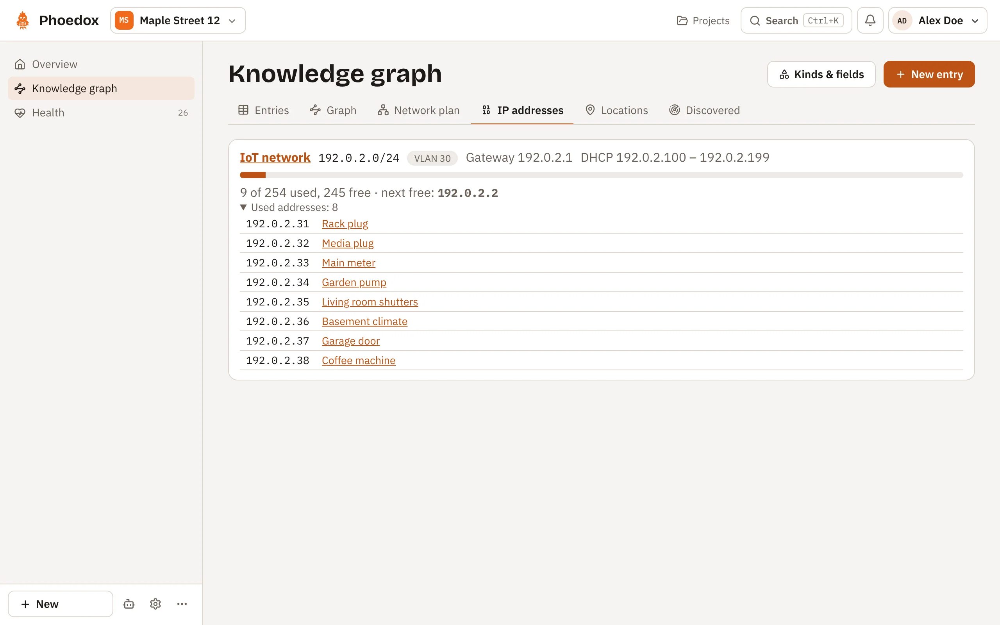

# Shelly

`com.phoedox.shelly` · version 0.1.0



Imports Shelly devices from the local network into the knowledge graph: devices with a switch and power metering become smart plugs, all others devices (manufacturer, model, MAC, IP address, firmware, generation, host name). AI clients get live power, energy, voltage, temperature, Wi-Fi signal and available firmware updates. Read-only: the plugin only reads and never switches. Works with Gen1 (/shelly, /status) and Gen2 and later (RPC over HTTP, /rpc/Shelly.GetStatus); MQTT and the Shelly Cloud are not used.

## What it adds

- **Tools for AI clients (MCP):**
  - `shelly.sync`: Import the configured Shelly devices into the knowledge graph now.
  - `shelly.status`: Live status of every configured Shelly: per output on/off, power (W), energy (kWh), voltage and temperature; Wi-Fi network and signal (dBm), IP address, uptime and available firmware update.
- **Runs on its own:** every 6 hours.

## Setup

1. A system administrator installs the plugin under **Administration → Plugins** (from the store, or the `.phxp` package).
2. A project owner enables it under **Project settings → Plugins** and enters the settings `url`, `device2_url`, `device3_url`, `device4_url`, `device5_url`, `device6_url`, `device7_url`, `device8_url`, `device9_url`, `device10_url`, `username`, `password`.

**Settings:** url (the first device, e.g. http://192.168.1.50), device2_url to device10_url (further devices, one address each: a plugin may only reach the hosts entered in its own address settings, so up to 10 devices per project; for more devices use the Home Assistant plugin), optional password (device password, sent only when a device asks for it: digest login as admin for Gen2 and later, basic login for Gen1; the same password for all devices) and optional username (Gen1 only, default admin). Shelly devices only speak plain HTTP on the local network, so use them on a trusted network or VLAN.

## Permissions

- `graph:write:device,smart_plug`: creates and updates entries of the kinds `device`, `smart_plug`.
- `secrets:url`: stores the setting `url`, encrypted with the project.
- `secrets:device2_url`: stores the setting `device2_url`, encrypted with the project.
- `secrets:device3_url`: stores the setting `device3_url`, encrypted with the project.
- `secrets:device4_url`: stores the setting `device4_url`, encrypted with the project.
- `secrets:device5_url`: stores the setting `device5_url`, encrypted with the project.
- `secrets:device6_url`: stores the setting `device6_url`, encrypted with the project.
- `secrets:device7_url`: stores the setting `device7_url`, encrypted with the project.
- `secrets:device8_url`: stores the setting `device8_url`, encrypted with the project.
- `secrets:device9_url`: stores the setting `device9_url`, encrypted with the project.
- `secrets:device10_url`: stores the setting `device10_url`, encrypted with the project.
- `secrets:username`: stores the setting `username`, encrypted with the project.
- `secrets:password`: stores the setting `password`, encrypted with the project.
- `net:fetch:config`: calls only the address entered as `url` in the plugin settings.

## Development

```bash
go test ./plugins/shelly/...
```

```bash
scripts/pack.sh shelly
```

The package lands in `dist/com.phoedox.shelly-0.1.0.phxp`. See the repository README for the layout of a plugin.
