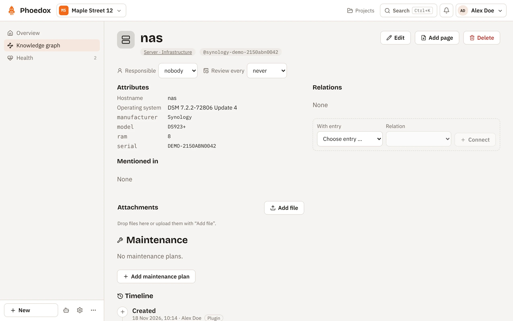

# Synology DSM

`com.phoedox.synology` · version 0.1.0



Imports a Synology NAS (hostname, model, DSM version, serial number, memory) into the knowledge graph as a server through the DSM Web API and gives AI clients its storage pools, volumes and drives with status and usage. Read-only: the plugin only signs in, reads and signs out.

## What it adds

- **Tools for AI clients (MCP):**
  - `synology.sync`: Import the Synology NAS into the knowledge graph now.
  - `synology.storage`: Storage of the Synology NAS: storage pools, volumes (status, file system, size, used and free space in GiB) and drives (model, size, status, SMART status, temperature).
- **Runs on its own:** every 6 hours.

## Setup

1. A system administrator installs the plugin under **Administration → Plugins** (from the store, or the `.phxp` package).
2. A project owner enables it under **Project settings → Plugins** and enters the settings `url`, `username`, `password`.

**Settings:** url (e.g. https://nas.example.org:5001, valid certificate), username and password (a dedicated DSM account in the administrators group, because DSM only shows system and storage information to administrators; the account must not use 2-step verification). If DSM blocks the Phoedox server after failed sign-ins, remove it from the block list under Control Panel > Security > Protection.

## Permissions

- `graph:write:server`: creates and updates entries of the kinds `server`.
- `secrets:url`: stores the setting `url`, encrypted with the project.
- `secrets:username`: stores the setting `username`, encrypted with the project.
- `secrets:password`: stores the setting `password`, encrypted with the project.
- `net:fetch:config`: calls only the address entered as `url` in the plugin settings.

## Development

```bash
go test ./plugins/synology/...
```

```bash
scripts/pack.sh synology
```

The package lands in `dist/com.phoedox.synology-0.1.0.phxp`. See the repository README for the layout of a plugin.
