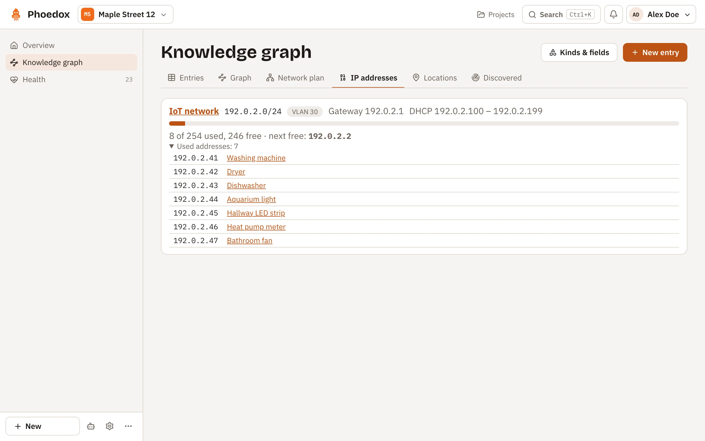

# Tasmota

`com.phoedox.tasmota` · version 0.1.0



Imports Tasmota devices from the local network into the knowledge graph: devices with a relay and an energy meter become smart plugs, all others devices (module or template name, firmware, hardware, IP address, MAC, host name, MQTT topic). AI clients get relay states, power, energy today/yesterday/total, voltage, current, Wi-Fi signal and uptime. Read-only: the plugin only sends the commands "Status 0" and "Module" over the HTTP API (/cm) and never switches; MQTT is not used.

## What it adds

- **Tools for AI clients (MCP):**
  - `tasmota.sync`: Import the configured Tasmota devices into the knowledge graph now.
  - `tasmota.status`: Live status of every configured Tasmota device: relay states (ON/OFF), power (W), energy today, yesterday and total (kWh), voltage, current, Wi-Fi network, quality and signal, IP address, firmware and uptime.
- **Runs on its own:** every 6 hours.

## Setup

1. A system administrator installs the plugin under **Administration → Plugins** (from the store, or the `.phxp` package).
2. A project owner enables it under **Project settings → Plugins** and enters the settings `url`, `device2_url`, `device3_url`, `device4_url`, `device5_url`, `device6_url`, `device7_url`, `device8_url`, `device9_url`, `device10_url`, `username`, `password`.

**Settings:** url (the first device, e.g. http://192.168.1.60), device2_url to device10_url (further devices, one address each: a plugin may only reach the hosts entered in its own address settings, so up to 10 devices per project), optional password (the web password, the same for all devices) and optional username (default admin). Tasmota only accepts the web password as URL parameters over plain HTTP, so it can appear in the device's own web log and is readable on the network; the plugin sends it only when set and removes it from its error messages. Recommended: no web password, with the devices on a trusted VLAN.

## Permissions

- `graph:write:device,smart_plug`: creates and updates entries of the kinds `device`, `smart_plug`.
- `secrets:url`: stores the setting `url`, encrypted with the project.
- `secrets:device2_url`: stores the setting `device2_url`, encrypted with the project.
- `secrets:device3_url`: stores the setting `device3_url`, encrypted with the project.
- `secrets:device4_url`: stores the setting `device4_url`, encrypted with the project.
- `secrets:device5_url`: stores the setting `device5_url`, encrypted with the project.
- `secrets:device6_url`: stores the setting `device6_url`, encrypted with the project.
- `secrets:device7_url`: stores the setting `device7_url`, encrypted with the project.
- `secrets:device8_url`: stores the setting `device8_url`, encrypted with the project.
- `secrets:device9_url`: stores the setting `device9_url`, encrypted with the project.
- `secrets:device10_url`: stores the setting `device10_url`, encrypted with the project.
- `secrets:username`: stores the setting `username`, encrypted with the project.
- `secrets:password`: stores the setting `password`, encrypted with the project.
- `net:fetch:config`: calls only the address entered as `url` in the plugin settings.

## Development

```bash
go test ./plugins/tasmota/...
```

```bash
scripts/pack.sh tasmota
```

The package lands in `dist/com.phoedox.tasmota-0.1.0.phxp`. See the repository README for the layout of a plugin.
