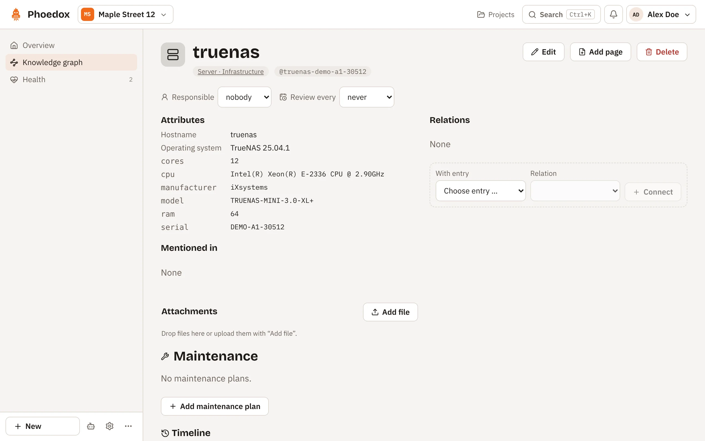

# TrueNAS

`com.phoedox.truenas` · version 0.1.0



Imports a TrueNAS system (hostname, TrueNAS version, model, serial number, memory) into the knowledge graph as a server through the REST API v2.0 and gives AI clients its ZFS pools (status, health, size, allocated and free space) and its SMB and NFS shares. Read-only. Works with TrueNAS SCALE / Community Edition and CORE as long as the REST API v2.0 is available.

## What it adds

- **Tools for AI clients (MCP):**
  - `truenas.sync`: Import the TrueNAS system into the knowledge graph now.
  - `truenas.pools`: ZFS pools of the TrueNAS system: name, status, healthy, path and size, allocated and free space in GiB.
  - `truenas.shares`: SMB and NFS shares of the TrueNAS system: protocol, name, path, enabled, read-only and comment.
- **Runs on its own:** every 6 hours.

## Setup

1. A system administrator installs the plugin under **Administration → Plugins** (from the store, or the `.phxp` package).
2. A project owner enables it under **Project settings → Plugins** and enters the settings `url`, `apikey`.

**Settings:** url (must be https, e.g. https://truenas.example.org; TrueNAS revokes API keys that are sent over plain HTTP) and apikey (an API key of a user with the Read-Only Administrator role, or of an administrator on releases without roles).

## Permissions

- `graph:write:server`: creates and updates entries of the kinds `server`.
- `secrets:url`: stores the setting `url`, encrypted with the project.
- `secrets:apikey`: stores the setting `apikey`, encrypted with the project.
- `net:fetch:config`: calls only the address entered as `url` in the plugin settings.

## Development

```bash
go test ./plugins/truenas/...
```

```bash
scripts/pack.sh truenas
```

The package lands in `dist/com.phoedox.truenas-0.1.0.phxp`. See the repository README for the layout of a plugin.
