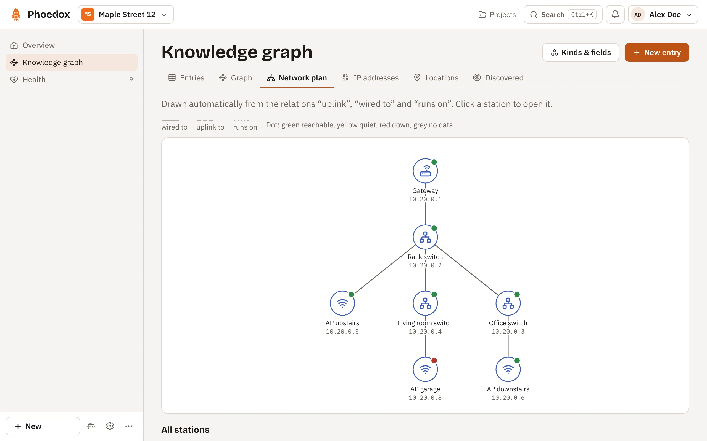

# UniFi Network

`com.phoedox.unifi` · version 0.1.0



Imports UniFi gateways, switches and access points into the knowledge graph (router, switch, access point, "wired to" their uplink) through the official UniFi Network API and lists connected clients for AI clients.

## What it adds

- **Tools for AI clients (MCP):**
  - `unifi.sync`: Import UniFi devices and their uplinks into the knowledge graph now.
  - `unifi.clients`: Clients connected to the UniFi network: name, IP, MAC, wired or wireless, and the device they are connected to.
- **Runs on its own:** every 6 hours.

## Setup

1. A system administrator installs the plugin under **Administration → Plugins** (from the store, or the `.phxp` package).
2. A project owner enables it under **Project settings → Plugins** and enters the settings `url`, `apikey`, `site`.

**Settings:** url (the console, e.g. https://192.168.1.1), apikey (UniFi Network → Settings → Control Plane → Integrations), optional site (name; default: the first site).

## Permissions

- `graph:read`: reads the entries of the project.
- `graph:write:router,switch,access_point`: creates and updates entries of the kinds `router`, `switch`, `access_point`.
- `secrets:url`: stores the setting `url`, encrypted with the project.
- `secrets:apikey`: stores the setting `apikey`, encrypted with the project.
- `secrets:site`: stores the setting `site`, encrypted with the project.
- `net:fetch:config`: calls only the address entered as `url` in the plugin settings.

## Development

```bash
go test ./plugins/unifi/...
```

```bash
scripts/pack.sh unifi
```

The package lands in `dist/com.phoedox.unifi-0.1.0.phxp`. See the repository README for the layout of a plugin.
