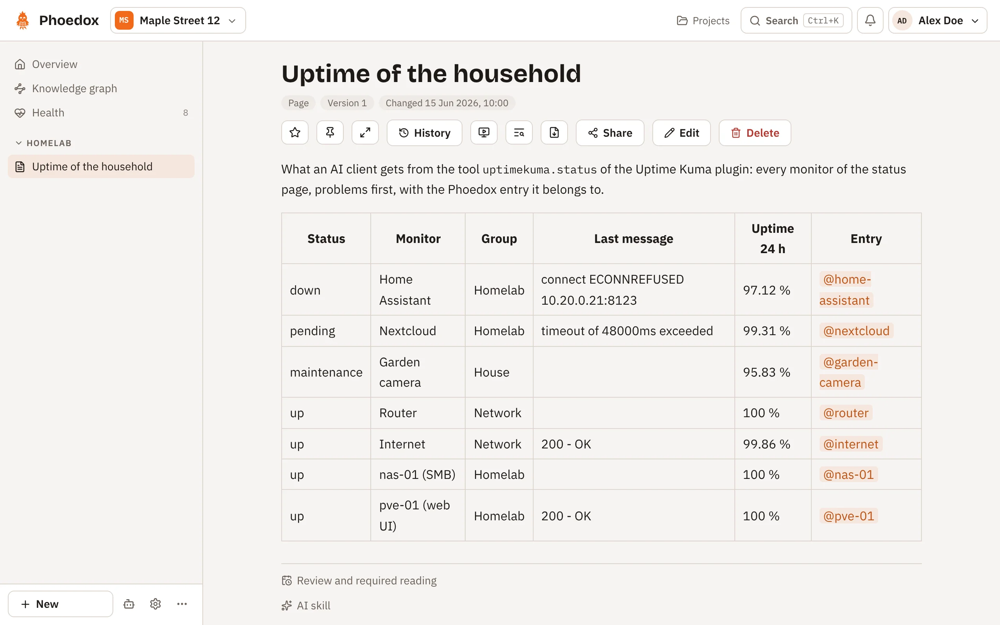

# Uptime Kuma

`com.phoedox.uptimekuma` · version 0.1.0



Gives AI clients the live state of the monitors on an Uptime Kuma status page (status, last message, last check, 24-hour uptime) together with the Phoedox entry each monitor belongs to (matched by host name, address or name). Read-only, no import.

## What it adds

- **Tools for AI clients (MCP):**
  - `uptimekuma.status`: All monitors of the status page: name, group, current status (up, down, pending, maintenance), last message, last check time, 24-hour uptime in percent and the matching Phoedox entry.
  - `uptimekuma.down`: Only the monitors of the status page that are not up (down, pending, maintenance or without heartbeat), with the matching Phoedox entry.

## Setup

1. A system administrator installs the plugin under **Administration → Plugins** (from the store, or the `.phxp` package).
2. A project owner enables it under **Project settings → Plugins** and enters the settings `url`, `status_page`.

**Settings:** url (e.g. https://status.example.org) and status_page (the slug of a status page that lists the monitors). Uses only the public status page JSON, so no credentials are needed; the plugin reads the knowledge graph only to find matching entries.

## Permissions

- `graph:read`: reads the entries of the project.
- `secrets:url`: stores the setting `url`, encrypted with the project.
- `secrets:status_page`: stores the setting `status_page`, encrypted with the project.
- `net:fetch:config`: calls only the address entered as `url` in the plugin settings.

## Development

```bash
go test ./plugins/uptimekuma/...
```

```bash
scripts/pack.sh uptimekuma
```

The package lands in `dist/com.phoedox.uptimekuma-0.1.0.phxp`. See the repository README for the layout of a plugin.
